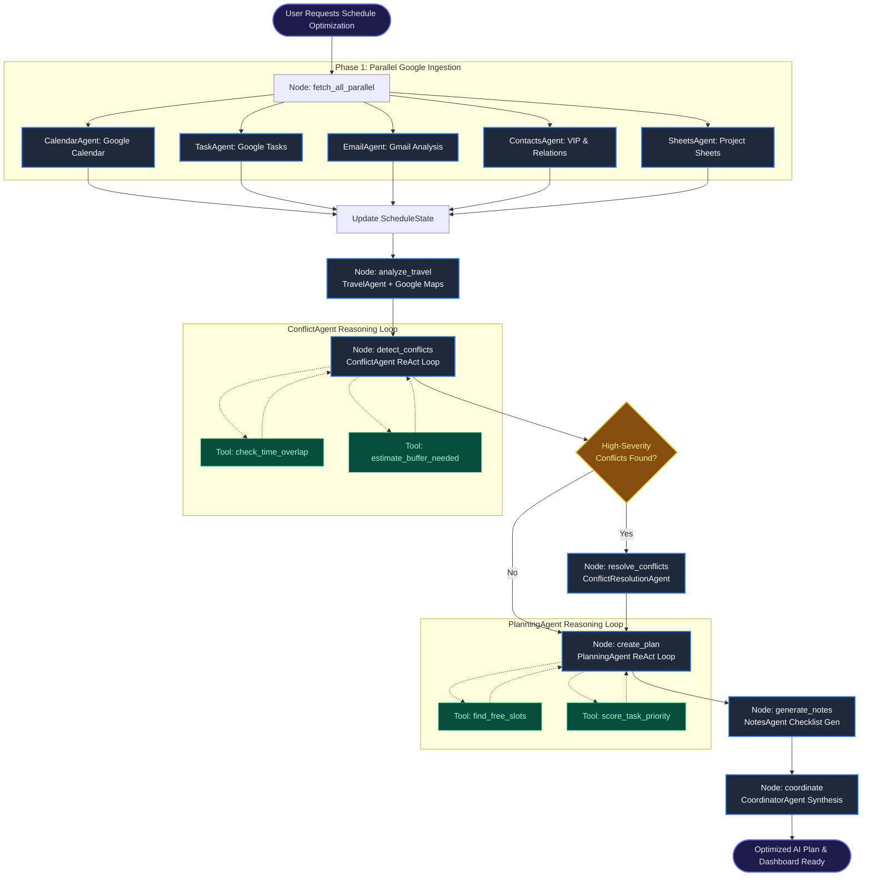

# Multi-Agent Architecture, LangGraph, and Execution Flow
## Autonomous Personal Task Automation & Daily Schedule Optimization

---

## 📑 Table of Contents
1. [Executive Summary](#1-executive-summary)
2. [The Three Core Pillars: Agent, Loop, Graph](#2-the-three-core-pillars-agent-loop-graph)
   - [Pillar 1: What is an Agent?](#pillar-1-what-is-an-agent)
   - [Pillar 2: What is a Loop?](#pillar-2-what-is-a-loop)
   - [Pillar 3: What is a Graph?](#pillar-3-what-is-a-graph)
3. [What is LangGraph and Why Do We Use It?](#3-what-is-langgraph-and-why-do-we-use-it)
   - [What is LangGraph?](#what-is-langgraph)
   - [LangChain vs. LangGraph](#langchain-vs-langgraph)
   - [Why LangGraph was Chosen for This System](#why-langgraph-was-chosen-for-this-system)
4. [Complete Multi-Agent Application Flow](#4-complete-multi-agent-application-flow)
   - [Dual Execution Modes](#dual-execution-modes)
   - [Live Mode Topology & Phase-by-Phase Breakdown](#live-mode-topology--phase-by-phase-breakdown)
   - [Graph Architecture Flowchart (Mermaid)](#graph-architecture-flowchart)
5. [Deep Dive into the 11 Specialized Agents](#5-deep-dive-into-the-11-specialized-agents)
6. [Inner ReAct Tool Loops in Action](#6-inner-react-tool-loops-in-action)
7. [State Management & Checkpointing (`ScheduleState`)](#7-state-management--checkpointing-schedulestate)
8. [Key Takeaways for Project Presentation & Viva](#8-key-takeaways-for-project-presentation--viva)

---

## 1. Executive Summary

This project is an **Autonomous Multi-Agent Schedule Optimizer and Personal Assistant**. Instead of relying on a single monolithic Large Language Model (LLM) prompt to parse calendars, evaluate tasks, compute commute durations, detect conflicts, and generate daily plans, the system decomposes the problem into **11 specialized agents** orchestrated by **LangGraph**.

### Why Single-Prompt LLMs Fail for Scheduling:
1. **Context Window Saturation & Hallucinations:** Asking one prompt to parse 20 emails, 15 calendar events, 10 tasks, spreadsheet data, and calculate traffic buffer times results in missed conflicts and inaccurate time math.
2. **Lack of Deterministic Tooling:** LLMs struggle with precise minute arithmetic (e.g., *Is 14:15 to 15:00 overlapping with 14:45 to 16:00?*). Agents need deterministic tools to execute math and API lookups.
3. **No Dynamic Decision Paths:** Real-world workflows require conditional branches—if high-severity conflicts exist, route to a resolution specialist; otherwise, proceed directly to optimization.

By combining **LangChain** (for LLM abstraction, prompt templates, and tool interfaces) and **LangGraph** (for cyclic state graphs, branching, and persistent memory), the system achieves industrial-grade reliability, speed, and accuracy.

---

## 2. The Three Core Pillars: Agent, Loop, Graph

The entire system is architected around three foundational concepts:

```
┌────────────────────────────────────────────────────────────────────────┐
│                              THE 3 PILLARS                             │
├──────────────────┬───────────────────────┬─────────────────────────────┤
│     1. AGENT     │        2. LOOP        │          3. GRAPH           │
│  (The Specialist │  (The Reasoning &     │   (The Orchestration &      │
│   Worker Unit)   │   Feedback Mechanism) │    State Machine System)    │
└──────────────────┴───────────────────────┴─────────────────────────────┘
```

---

### Pillar 1: What is an Agent?

An **Agent** is an autonomous, goal-driven software entity that combines:
1. **An LLM Brain:** Powered by models like Google Gemini 2.5 Flash / Pro.
2. **Dedicated System Persona & Instructions:** Fine-tuned prompt steering its exact domain of expertise.
3. **Tools & Data Sources:** Access to external APIs (Google Calendar, Gmail, Tasks, Maps, Sheets) or custom computation functions (`check_time_overlap`, `find_free_slots`).
4. **Structured Output Contracts:** Standardized JSON schemas enforcing clean handoffs between agents.

#### Categorization of Agents in this Project:
- **Data Ingestion Agents (5):** `CalendarAgent`, `TaskAgent`, `EmailAgent`, `ContactsAgent`, `SheetsAgent` — Extract, filter, and sanitize domain data.
- **Analytical & Spatial Agents (2):** `TravelAgent` (calculates travel buffers with Google Maps API), `NotesAgent` (generates prep checklists).
- **ReAct Reasoning Agents (2):** `ConflictAgent`, `PlanningAgent` — Use iterative tool-calling to solve logic puzzles.
- **Remediation & Synthesis Agents (2):** `ConflictResolutionAgent` (proposes trade-offs), `CoordinatorAgent` (compiles the final executive briefing).

---

### Pillar 2: What is a Loop?

A **Loop** represents the feedback and iterative reasoning cycle that distinguishes true agentic AI from simple linear prompt-response chains.

In this project, loops operate at **two distinct levels**:

#### A. The Inner Agent Loop (ReAct: Reason + Act)
In `ConflictAgent` and `PlanningAgent`, the agent does not output a final answer immediately. Instead, it enters a `Thought → Action → Observation → Thought` loop:

```
   ┌────────────────────────────────────────────────────────┐
   │                  ReAct Reasoning Loop                  │
   └───────────────────────────┬────────────────────────────┘
                               │
                               ▼
                        ┌─────────────┐
                        │   THOUGHT   │ ◄─────────────────────┐
                        │ (LLM decides│                       │
                        │  what to do)│                       │
                        └──────┬──────┘                       │
                               │                              │
                               ▼                              │
                        ┌─────────────┐                       │
                        │   ACTION    │                       │
                        │ (Calls Tool,│                       │
                        │ e.g., slot) │                       │
                        └──────┬──────┘                       │
                               │                              │
                               ▼                              │
                        ┌─────────────┐                       │
                        │ OBSERVATION │                       │
                        │ (Tool output│                       │
                        │  returned)  │                       │
                        └──────┬──────┘                       │
                               │                              │
                               ▼                              │
                     [Need More Info?] ─── YES ───────────────┘
                               │
                               NO (Goal Met)
                               │
                               ▼
                        ┌─────────────┐
                        │ FINAL PLAN  │
                        └─────────────┘
```

1. **Step 1 (Thought):** *"I have a 90-minute task due at 17:00. Let me check what free calendar slots exist."*
2. **Step 2 (Action):** Calls tool `find_free_slots(events_json, duration=90)`.
3. **Step 3 (Observation):** Tool returns `[{"start": "13:00", "end": "14:30"}]`.
4. **Step 4 (Thought):** *"13:00-14:30 works. Now let me score task priority against other backlog tasks."*
5. **Step 5 (Action):** Calls tool `score_task_priority(...)`.
6. **Step 6 (Final Output):** Produces structured schedule.

#### B. The Outer Graph Loop (Conditional State Transitions)
If conflicts are detected during schedule analysis, LangGraph executes conditional routing:
- **No High-Severity Conflicts:** Straight path to `create_plan`.
- **High-Severity Conflicts:** Branch to `resolve_conflicts` (ConflictResolutionAgent), which generates mitigation options (reschedule, drop, delegate, buffer expansion) before feeding back into `create_plan`.

---

### Pillar 3: What is a Graph?

A **Graph** is a mathematical structure consisting of **Nodes** (vertices) connected by **Edges** (directed links). 

In modern agentic AI, graphs represent **State Machines** where:
- **Nodes = Agent Functions or Computational Steps:** Each node takes the global state, executes work, and returns updated state fields.
- **Edges = Transitions:** Control flow directing which node runs next.
- **Conditional Edges = Dynamic Routers:** Functions that inspect the state (e.g., checking `conflict_severity == 'high'`) and choose the destination node at runtime.
- **State = Shared Context Memory:** A centralized TypedDict (`ScheduleState`) flowing through all nodes.

```
       [Node A] ───(Standard Edge)───► [Node B]
                                           │
                                 (Conditional Edge)
                                   [Inspect State]
                                  /               \
                          [If Severity High]   [If Normal]
                                /                   \
                               ▼                     ▼
                          [Node C]                [Node D]
```

---

## 3. What is LangGraph and Why Do We Use It?

### What is LangGraph?

**LangGraph** is an open-source library built by the LangChain team designed specifically for building **stateful, multi-actor, cyclic applications with LLMs**.

While standard LangChain (LCEL - LangChain Expression Language) excels at linear Directed Acyclic Graphs (DAGs) like `Prompt → LLM → OutputParser`, complex multi-agent workflows require:
- Cycles and loops (e.g., draft → critique → revise).
- Conditional branching based on intermediate agent evaluations.
- Shared multi-step state mutations.
- Checkpointing (saving workflow state after every node for recovery and user pauses).

### LangChain vs. LangGraph

| Dimension | LangChain (LCEL) | LangGraph |
|---|---|---|
| **Topology** | Linear chains (A → B → C) | Arbitrary graphs (Cycles, branches, loops, parallel nodes) |
| **State Management** | Ephemeral, passed input-to-output | Centralized, mutable, persistent state object |
| **Branching** | Static conditional runnables | Dynamic conditional edges evaluating runtime state |
| **Error Handling** | Whole-chain failure | Node-level isolation and fault-tolerant fallbacks |
| **Persistence** | None by default | Built-in Checkpointing (`PostgresSaver`, `MemorySaver`) |
| **Agent Paradigm** | Single-agent execution | Multi-agent coordination and hierarchy |

### Why LangGraph was Chosen for This System

1. **Parallel Execution Node (`fetch_all_parallel`):**
   Instead of sequentially calling Google Calendar, Google Tasks, Gmail, Contacts, and Sheets (which would take 15–20 seconds), LangGraph encapsulates parallel worker threads in a single node, cutting ingestion latency to ~2–3 seconds.

2. **Conditional Dynamic Routing (`_route_after_conflicts`):**
   Not every user has impossible calendar conflicts. LangGraph allows the system to skip the heavy `ConflictResolutionAgent` when the schedule is clean, saving LLM latency and tokens.

3. **Isolated Fault Tolerance:**
   If a user has not connected Google Sheets or Contacts, LangGraph ensures the node catches the exception, populates a graceful default in the `ScheduleState`, and allows downstream nodes (`ConflictAgent`, `PlanningAgent`) to proceed without crashing.

4. **Multi-User State Persistence (`PostgresSaver`):**
   Every graph execution is tagged with a `thread_id` (e.g., `user-{user_id}`). LangGraph saves the exact state at every step into PostgreSQL, enabling audit trails, plan re-runs, and instant state recovery.

---

## 4. Complete Multi-Agent Application Flow

### Dual Execution Modes

The unified `ScheduleAgentGraph` supports two runtime modes:

1. **Live Mode (`execute_live(user, db)`):** Auto-fetches real data across all connected Google Workspace services via OAuth2, executes Google Maps distance matrix lookups, detects conflicts, resolves high-severity bottlenecks, and produces a real-time schedule.
2. **Manual Mode (`execute(meetings, tasks)`):** Accepts user-defined JSON inputs from the frontend playground for instant simulation and what-if scenario testing.

---

### Live Mode Topology & Phase-by-Phase Breakdown

```
========================================================================================
                               LIVE GRAPH TOPOLOGY
========================================================================================

 [START]
    │
    ▼
 ┌────────────────────────────────────────────────────────────────────────┐
 │ PHASE 1: PARALLEL DATA INGESTION                                      │
 │ Node: `fetch_all_parallel` (ThreadPoolExecutor: 5 Worker Agents)       │
 │  ├── CalendarAgent  ──► Fetches real Google Calendar events           │
 │  ├── TaskAgent      ──► Fetches active Google Tasks & due dates       │
 │  ├── EmailAgent     ──► Scans Gmail for urgent threads & deadlines    │
 │  ├── ContactsAgent  ──► Identifies VIP contacts & attendees           │
 │  └── SheetsAgent    ──► Syncs tracked items from Google Sheets        │
 └───────────────────────────────────┬────────────────────────────────────┘
                                     │
                                     ▼
 ┌────────────────────────────────────────────────────────────────────────┐
 │ PHASE 2: SPATIAL & TEMPORAL ANALYSIS                                  │
 │ Node: `analyze_travel` (TravelAgent + Google Maps API)                 │
 │  └── Computes real commute times & traffic buffers between venues     │
 │                                                                        │
 │ Node: `detect_conflicts` (ConflictAgent - ReAct Tool Loop)             │
 │  └── Uses `check_time_overlap` & `estimate_buffer_needed` tools       │
 └───────────────────────────────────┬────────────────────────────────────┘
                                     │
                                     ▼
                      ┌─────────────────────────────┐
                      │ CONDITIONAL ROUTING EDGE    │
                      │ `_route_after_conflicts`    │
                      └──────────────┬──────────────┘
                                     │
                 ┌───────────────────┴───────────────────┐
                 │ High Severity                         │ Low/Medium Severity
                 ▼                                       ▼
 ┌───────────────────────────────────────┐               │
 │ PHASE 3: CONDITIONAL REMEDIATION      │               │
 │ Node: `resolve_conflicts`             │               │
 │ Agent: ConflictResolutionAgent        │               │
 │ (Reschedules, drops, or delegates)    │               │
 └───────────────────┬───────────────────┘               │
                     │                                   │
                     └───────────────────┬───────────────┘
                                         │
                                         ▼
 ┌────────────────────────────────────────────────────────────────────────┐
 │ PHASE 4: PLANNING, NOTES & COORDINATION                               │
 │ Node: `create_plan` (PlanningAgent - ReAct Tool Loop)                  │
 │  └── Uses `find_free_slots` & `score_task_priority` tools             │
 │                                                                        │
 │ Node: `generate_notes` (NotesAgent)                                   │
 │  └── Creates meeting preparation briefs & actionable checklists       │
 │                                                                        │
 │ Node: `coordinate` (CoordinatorAgent)                                 │
 │  └── Synthesizes executive summary & final output JSON                │
 └───────────────────────────────────┬────────────────────────────────────┘
                                     │
                                     ▼
                                   [END]
```

---

### Graph Architecture Flowchart



---

## 5. Deep Dive into the 11 Specialized Agents

| # | Agent Name | Primary Responsibility | Key Inputs | Key Outputs / Tools |
|---|---|---|---|---|
| 1 | **CalendarAgent** | Ingests and standardizes calendar events. Identifies fixed vs. flexible time blocks. | Google Calendar API / Manual list | Formatted events, busy blocks, start/end windows |
| 2 | **TaskAgent** | Parses task backlog, deadlines, estimated effort, and completion status. | Google Tasks API / DB tasks | Normalized task list with urgency and effort weights |
| 3 | **TravelAgent** | Calculates geographic transit between in-person meetings. | Event locations, start times | Commute duration, travel buffer recommendations (Google Maps API) |
| 4 | **EmailAgent** | Triage inbox for action items, meeting requests, and urgent stakeholder deadlines. | Gmail API (Unread/Starred) | Extracted action items, sender urgency scores |
| 5 | **ContactsAgent** | Maps meeting attendees to VIP priority and organizational relationships. | Google People API | VIP attendee flags, context notes |
| 6 | **SheetsAgent** | Scans external trackers or project spreadsheets for deadlines and deliverables. | Google Sheets API | Structured tabular rows mapped to actionable tasks |
| 7 | **NotesAgent** | Generates executive briefings, prep materials, and meeting checklists. | Planned events, linked tasks | Structured agenda notes and prep checklists |
| 8 | **ConflictAgent** *(ReAct)* | Detects physical overlaps, double-bookings, and inadequate commute buffers. | Meetings, tasks, travel estimates | Conflict list with severity tags (`high`, `medium`, `low`). **Tools:** `check_time_overlap`, `estimate_buffer_needed` |
| 9 | **ConflictResolutionAgent** | Formulates concrete remediation strategies for severe scheduling roadblocks. | High-severity conflicts, calendar analysis | Reschedule proposals, task delegations, meeting compression options |
| 10 | **PlanningAgent** *(ReAct)* | Generates the time-blocked optimized daily schedule. | Free slots, prioritized tasks, travel constraints | Chronological time-blocks, task placements. **Tools:** `find_free_slots`, `score_task_priority` |
| 11 | **CoordinatorAgent** | Assembles all outputs into a coherent, executive-level natural language briefing. | All agent state fields | Clean Markdown overview, efficiency metrics, summary recommendations |

---

## 6. Inner ReAct Tool Loops in Action

Two of the most critical agents—`ConflictAgent` and `PlanningAgent`—leverage **LangGraph's prebuilt ReAct agent (`create_react_agent`)**.

### Why ReAct is Essential for Scheduling:
In simple prompt engineering, the LLM attempts to guess time math in a single forward pass. With ReAct, the model is equipped with Python functions executed locally.

### Example 1: `ConflictAgent` Tool Execution

#### Tool 1: `check_time_overlap`
```python
@tool
def check_time_overlap(start_a: str, end_a: str, start_b: str, end_b: str) -> str:
    """Check if two time windows overlap using exact minute math."""
    # Converts HH:MM or ISO times to minutes since midnight
    # Calculates max(start_a, start_b) and min(end_a, end_b)
    # Returns {"overlap": True, "overlap_minutes": 30}
```

#### Tool 2: `estimate_buffer_needed`
```python
@tool
def estimate_buffer_needed(location_a: str, location_b: str) -> str:
    """Estimates buffer time based on venue distance or virtual meeting flags."""
    # Detects virtual markers (Zoom/Meet/Online -> 0 min)
    # Detects cross-city transit (-> 45 min)
    # Returns {"buffer_minutes": 45, "confidence": "high"}
```

---

### Example 2: `PlanningAgent` Tool Execution

#### Tool 1: `find_free_slots`
```python
@tool
def find_free_slots(events_json: str, duration_minutes: int) -> str:
    """Calculates all unoccupied gaps during working hours (08:00 - 20:00)."""
    # Computes busy interval unions
    # Returns available windows: [{"start": "10:30", "end": "12:00"}]
```

#### Tool 2: `score_task_priority`
```python
@tool
def score_task_priority(title: str, deadline: str, estimated_duration_minutes: int) -> str:
    """Applies an urgency x effort heuristic to rank tasks from 0 to 100."""
    # Evaluates overdue status, upcoming deadlines, duration constraints
    # Returns {"score": 90, "priority": "critical", "schedule_today": True}
```

---

## 7. State Management & Checkpointing (`ScheduleState`)

### The Graph State Schema

In LangGraph, data is not passed as loose strings. It is strictly typed through a centralized `TypedDict` schema (`ScheduleState` in [agent_graph.py](file:///c:/Users/arunk/Projects/College/Final-Year%20Project/GONE/backend/graph/agent_graph.py#L40-L64)):

```python
class ScheduleState(TypedDict):
    """Global state flowing through every node in the LangGraph."""
    # Execution Mode
    mode: str                          # "manual" or "live"
    
    # Inputs
    meetings: List[Dict[str, str]]
    tasks: List[Dict[str, str]]
    
    # Ingested Google Data
    google_emails: Dict[str, Any]
    google_contacts: Dict[str, Any]
    google_sheets: Dict[str, Any]
    google_notes: Dict[str, Any]
    
    # Analysis & Intermediate Reasoning
    calendar_analysis: Dict[str, Any]
    task_analysis: Dict[str, Any]
    conflicts: Dict[str, Any]
    resolution_plan: Dict[str, Any]    # Populated only if high-severity conflicts exist
    travel_plan: Dict[str, Any]
    
    # Final Deliverables
    optimized_plan: Dict[str, Any]
    final_response: str
    
    # User Context
    user: Any                          # database.models.User
    db: Any                            # SQLAlchemy Session
```

### Checkpointing & Memory Persistence

LangGraph utilizes checkpointers to snapshot the entire `ScheduleState` after every node execution:
- **`MemorySaver`:** In-memory checkpointing used for fast local development and manual simulations.
- **`PostgresSaver`:** Production-grade persistence storing state directly into PostgreSQL (`langgraph_checkpoints` table).
- **Session Scoping (`thread_id`):** Each user execution runs under `thread_id=f"user-{user.id}"`, preventing race conditions across multi-tenant requests.

---

## 8. Key Takeaways for Project Presentation & Viva

When presenting or explaining this architecture, emphasize these **five core engineering achievements**:

1. **Modular Specialization (Agent Principle):**
   Instead of one giant prompt doing everything poorly, 11 dedicated agents handle distinct responsibilities with tailored schemas and system instructions.

2. **Deterministic Computation via ReAct (Loop Principle):**
   The system doesn't let LLMs "guess" time arithmetic. Agents use deterministic Python tools (`check_time_overlap`, `find_free_slots`) in iterative loops.

3. **Dynamic State Machine Orchestration (Graph Principle):**
   LangGraph governs execution order, enables concurrent data fetching, handles conditional branching for conflict resolution, and ensures fault isolation.

4. **Multi-Service Real-World Integration:**
   Native connectivity to 6 Google APIs (Calendar, Tasks, Gmail, Contacts, Sheets, Maps) with real-time OAuth2 token management.

5. **Production Readiness:**
   Features database-backed checkpointing (`PostgresSaver`), background execution threads to avoid blocking FastAPI's event loop, and fallback chains if rate limits occur.

---
*Generated for the Personal Task Automation (GONE) Project Architecture Documentation.*
